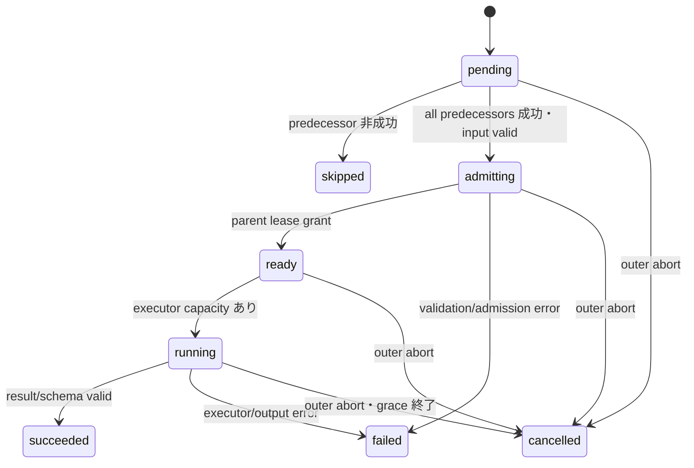

# One-shot workflow execution and CLI composition

## Context

承認済み SPEC-034AqzLDP7xm2lCmDoyKzg と ADR-034AtVcQU6kREPV6w4aHs4 を実装可能な境界へ落とす。issue #62 Triage 2026-10-04 と #69 slice B が正本。overview.md は読み取り済みの全体地図とし、この chain の責務・依存方向は shared ADR D1-D7 を引用する。overview と shared ADR は変更しない。

現在の compiler は input と declared output を materialize するが job output validation の公開 seam がない。InvocationToolRuntime は job lease・借用 scope・owner/global metrics を持つ。RunArtifactStore と ArtifactReader は存在し、read/registry/CLI への配線が未導入。これらの正本を再実装せず接続する。

## Scope

### In Scope

- injected executor に対する one-shot DAG engine、bounded job capacity、resource admission、collect-all、outer timeout/abort。
- canonical read の artifact publication/consumer、invocation 単一 runtime/store、Worker 子 scope の writeScope narrowing。
- policy の workflow.maxJobs / workflow.artifacts、workflow run <path>、combined envelope、関連 regression。

### Out of Scope

- daemon/status API/polling、開始後 DAG mutation、optional jobs、automatic payload-to-artifact conversion。
- provider/dependency 追加、policy.yaml 二つや overview/shared ADR の変更、APM bundled CLI 再生成、push/PR。
- full canonical check と実モデルによる費用比較。canonical check は coordinator merge run に defer。

## Components and Boundaries

| Component | 所有する責務 | 借用する契約 |
| --- | --- | --- |
| workflow/compiler | definition/bindings/schema validation、compiled semantic edges、個別 public output | core schema、ToolCatalog/WorkerCatalog、ResourceInference |
| workflow/engine | job 状態、ready queue、maxJobs、論理 terminal、公開 projection | injected executors、admission/abort/metrics ports |
| tool-runtime/invocation | operation capacity/resources/cancellation、job leases、owner/global metrics | canonical ResourceManager/OperationManager/ToolScheduler |
| tool-runtime/access | literal writeScope canonicalization、scope permission と parent containment | core path/claim predicates |
| workflow/artifacts | bounded bytes、run identity/provenance、cleanup | 既存 ArtifactReader と新 ArtifactPublisher |
| runtime-pi/run | Worker の model/session、子 timeout/budget/journal、借用 scope | core writeScope helper、WorkerExecutionBinding |
| cli/workflow-run | loader/policy/compiler と runtime/store/executors の composition、最終 envelope | 上記 public APIs、既存 CLI input/format/error 契約 |

workflow は runtime-pi/Pi SDK を import しない（D1）。既存 no-pi-deps.test.ts は manifests と source import/export/dynamic import の両方を検査する。CLI だけが runWorker と Pi helper-backed write/edit/ls handlers を注入する。

### Compiler と engine API

CompiledWorkflow に `validateJobOutput(jobId, value): JsonValue` を追加する。既存 private JobValidation.output を使って validate し、invalid/non-JSON は INVALID_OUTPUT、valid は JSON snapshot を返す。Worker output schema と canonical tool output schema を engine に複製しない。既存 materializeJobInput/materializeOutput/materializeOutputs の契約は維持する。

engine の public API は次の概念を持つ。具体名もこの設計で固定する。

```ts
interface WorkflowExecutionContext {
  jobId: string;
  job: CompiledJob;
  input: JsonValue;
  signal: AbortSignal;
  parentLease: ResourceLease;
}
interface WorkflowExecutorResult {
  result: JsonValue;
  meta?: Record<string, JsonValue>;
}
interface WorkerExecutor {
  execute(context: WorkflowExecutionContext): Promise<WorkflowExecutorResult>;
}
interface ToolExecutor {
  execute(context: WorkflowExecutionContext): Promise<WorkflowExecutorResult>;
}
interface WorkflowEnginePorts {
  worker: WorkerExecutor;
  tool: ToolExecutor;
  acquireJobLease(context: Omit<WorkflowExecutionContext, "parentLease">): Promise<ResourceLease>;
  releaseJobLease(lease: ResourceLease): void;
  abort(reason: unknown): void;
  executionMetrics(jobId?: string): ExecutionMetrics | null;
}
// ports の結果を engine が schema validate してから downstream に渡す。
runWorkflow({ workflow, ports, maxJobs, timeoutMs, signal, abortGraceMs, now });
```

maxJobs は正の safe integer、timeoutMs は正の有限 ms、abortGraceMs は非負の有限 ms（既定 5000）、now は duration 用の注入 clock。invalid option は INVALID_REQUEST とし executor を呼ばない。engine API は runtime/store を生成しない。timeout trigger は engine start 時に作り、definition/input load と compile の時間を含めない。

executor meta は Pi 型を import せず JSON data を port 経由で渡す。engine が durationMs/execution を正本として上書きする。Worker 成功/失敗の model/usage/turns/toolCalls/changes/savings は adapter が明示 metadata field のみ選択する。private result/input、error details/cause 全体を meta へ移さない。

## Data and Control Flow

### Ready queue と admission

compiled.edges のみから predecessor/successor を作る。all required predecessors の成功後に compiler.materializeJobInput を一度呼ぶ。非成功 predecessor があれば dependency_failed skip。失敗は affected downstream へだけ伝播する。needs/$from/inferred edges の実装は compiler のみ、resource conflicts から新 edge を作らない。



内部状態は pending/admitting/ready/running と terminal succeeded/failed/skipped/cancelled。public jobs は terminal のみ。ID は code-unit 昇順とし、integer-like ID の object enumeration と localeCompare に頼らない。compiled.order/edges は変更しない。

新たに runnable になった jobs は ID 順で全て admission を要求する。admitting/ready は maxJobs を消費せず、実際の executor 呼出し直前から executor promise の settle（または logical detach）までを slot とする。grant/terminal イベントで ready queue を pump し、同じ pump の ready jobs を ID 順で上限まで start。resource の同時 grant の順序まで実行時刻の deterministic 性を保証するものではない。非 conflict job は canonical ResourceManager の bypass で進める。timer は timeout/grace にのみ使い、scheduler に polling loop を設けない。

admission に resourceManifest を渡す場合は compiled safety manifest をそのまま使い、writeScope を渡して safety claims を permission 検査しない。同じ root/symlink/process/deny policy と effective tools、signal を使う。manifest 省略では ResourceAccess の conservative fallback を維持し、unknown を無アクセスに変えない。

input/admission/execute/output-validation error は当該 job の failed。unrelated jobs を止めない。result map は成功し schema validate した JSON snapshots だけを持ち、state map は全 job の terminal/result-presence を表す。最後に output 名を昇順で一つずつ materializeOutput し、失敗した output のみ除外して独立 valid outputs を保持する。

### Parent safety と Worker 子 permission（D4/D7）

core/worker/write-scope.ts に既存 runtime-pi の extractWriteScope を移し public export。既存エラー形と、string/path object array の literal path set を維持する。input が deferred な時点で permission を確定せず、materialize 後の input を使う。

ResourceAccess に `prepareWorkerManifest(safetyManifest)` の seam を追加する。この seam は resourceManifest を付けずに prepare した同じ ResourceAccess の writeClaims を使う。literal path の canonicalization を core normalization の glob approximation に置き換えない。

- writeScope あり: safety reads を保持し、writes/produces をそれぞれ safety bucket に contained な authoritative exact writeClaims へ narrow。祖先/root-exclusive mkdir safety は permission として残さない。入力 writeScope と safety の両方を満たす対象だけに permission を与える。
- writeScope なし: safety manifest の宣言を保持する。未知 manifest の fallback を緩めない。
- 最後は既存 createWorkerScope.ready() と ResourceManager の parent containment/readStrictness inheritance を通す。record mode の root-shared safety は既存 canonical 準備が所有する。declared reads を独自に緩めない。

この seam は scope preparation の正本を使い、canonical normalized claims を返す。WorkerExecutionBinding に optional resourceManifest を追加し、runtime-pi/run が toolOptions/handlers/scope へ同じ narrowed manifest を渡す。single-worker は binding 省略で従来経路。Pi helper operations の observeAccess を scope に接続し、mkdir support が fail-closed authorization を迂回しない。

### Outer cancellation と physical settlement

engine の timeout は policy.execution.timeoutMs、CLI --timeout は restrictPolicy の既存 narrowing（上限超過は POLICY_VIOLATION）。external signal/timeout の first cause を保持し、ports.abort(reason) を一度呼ぶ。CLI の invocation controller を abort し、runtime と store に同じ lifetime signal を渡す。Worker 子 timeout/budget はその scope に閉じる。

preabort は admission/executor を呼ばず、全 job を cancelled にして TIMEOUT/ABORTED の aggregate を返す。CLI context を初回 admission 時に lazy 作成するため、preabort 時には abort を拒否する RunArtifactStore constructor を呼ばず meta.execution は null。作成後なら execution zero object と null を区別する。

abort 時には新規起動と downstream materialization を止め、pending/admitting/ready を cancelled、取得済み未実行 lease は即時 release。admission promise が abort 後に grant した場合も release し、executor は呼ばない。全 promise に成功/失敗 continuation を登録し unhandled rejection を避ける。

running executor は composite signal を受け取り、同一の outer abort deadline から default 5000ms まで cooperative settle を待つ。abort を観測した job は executor が成功を返しても cancelled。grace 超過では cancelled を確定し slot を論理解放するが、その executor promise の finally が実行されるまで開始済み parent lease を release しない。late result/meta/publication は finalized workflow outcome を変更しない。

executor adapter は自身の child scope を finally dispose し、その後に engine が parent lease を release する。canonical ResourceManager.release は child tokens が残る parent を closing として保持するため、Worker adapter が bounded grace で返っても detached operation の物理 settle 前に foreign job を入れない。cancelled slot に新 job を起動することはない。operation capacity/tokens の維持は既存 OperationManager/ToolScheduler が所有する。

CLI finally は runtime.dispose と store.dispose を行う。drain/dispose は既存 bounded grace を使い、未 settle の executor を Promise.all で無期限 await しない。logical return と physical completion を混同せず、runtime metrics の byState/active interval は canonical snapshot を採用する。store payload の abort cleanup は即時であり、遅い publication は closed store が拒否する。

### Artifact ports と read union（D4/D5）

既存 ArtifactReader を再利用し、新 port は ArtifactPublisher のみ。

```ts
interface ArtifactPut {
  producer: ArtifactProducer;
  data: string | Uint8Array;
}
interface ArtifactPublisher {
  readonly maxArtifactBytes: number;
  put(value: ArtifactPut): ArtifactReference;
}
```

ArtifactPut は既存 workflow 型を tool-runtime の canonical artifact.ts に移して互換 re-export。RunArtifactStore は existing put/read を使い publisher の cap getter を追加する。InvocationToolRuntimeOptions は optional artifacts:{reader,publisher} を借用する。internal scope binding が ownerId を read に渡し、input から producer jobId を選択できない。store 自体を Worker scope が dispose しない。

read input は互いに排他的な次の union。additionalProperties:false とし mixed mode を拒否する。

| Mode | Input | Result |
| --- | --- | --- |
| 既存 workspace line read | {path, offset?, limit?, byteInLine?} | 既存 content + ReadToolDetails を維持 |
| workspace publication | {path, artifact: name} | content:[], details:{artifact:ArtifactReference} |
| artifact byte read | {source:{kind:"artifact",reference}, offset, maxBytes} | bounded text content、details:{offset,nextOffset,eof} |

workspace publication は既存 sandbox/deny/regular-file/image/NUL sniff 制約を使う。maxArtifactBytes+1 source bytes まで chunk read し、overflow は store.put 前に拒否。stat の size のみを信用せず、途中の増加と abort を再確認する。full-file readFile、無制限 decoding、cap 後の mutation を禁止。workspace path に対する shared claim は通常 read と同じ。

artifact byte read は既存 reader の byte slice copy と validation を使い、workspace resolver/deny matcher を呼ばない。catalog.resources は artifact mode に explicit {reads:[],writes:[],produces:[]}、workspace modes は path claim。artifact URI を path として読ませない。offset/nextOffset は source byte 位置、maxBytes は正の safe integer。既存 store maxReadBytes 以下を要求し、decode は bounded slice のみ（byte 境界の部分 UTF-8 は replacement を許可）。decoded UTF-8 replacement のため text byte 長は source maxBytes より増え得るが、保持量は bounded slice の定数倍であり byte continuation を文字 offset と混同しない。

publisher が無い standalone runtime では publication、reader が無ければ artifact consumption を INVALID_REQUEST で拒否する。catalog と実 handler の input union/description/output schema を同時更新し、Pi adapter の schema も同じ定義を使う。reference JSON は通常の $from result として運び、自動型変換しない。Worker prompt には reference/preview だけを materialize する。

CLI publisher wrapper は store.put 成功後の reference metadata だけを ledger に保持する。abort/dispose で store entries が空になっても ledger から unavailable projection を作れる。private preview の自動公開を避け top-level artifacts は projectArtifactMetadata(reference,{includePreview:false})。公開 reference/preview は declared outputs に指定したものだけ。artifact body と private result を stdout に載せない。

### Policy schema と layering（D2 の互換的 extension）

core/policy/workflow.ts に WorkflowPolicy/resolveWorkflowPolicy と artifact cap の既定・validation を一箇所に置く。RuntimePolicy.workflow は既存 typed fixtures と互換な optional field、load/normalize は常に補完。raw complete/partial policy は workflow を optional とし、部分 cap 指定も残りを default 補完する。

| Field | Default | Validation | User | Project |
| --- | --- | --- | --- | --- |
| workflow.maxJobs | 1 | positive safe integer | replace | min |
| workflow.artifacts.maxArtifactBytes | 8388608 | nonnegative safe integer | replace | min |
| workflow.artifacts.maxTotalBytes | 33554432 | nonnegative safe integer | replace | min |
| workflow.artifacts.maxPreviewBytes | 2048 | nonnegative safe integer | replace | min |
| workflow.artifacts.maxReadBytes | 65536 | positive safe integer | replace | min |

loadPolicy の trusted builtin/user merge 後、project restriction 前に resolveWorkflowPolicy を呼び raw policy に defaults を補完する。既存 merge.ts の restrict key 集合に artifact 四キーを追加する（shared ADR D2 の closed keys を承認済み local ADR が拡張）。trusted 未指定・project maxJobs=16 は1、user maxJobs=4・project8 は4、project2 は2。zero cap は保存/preview を明示的に無効化できる。maxArtifactBytes と maxTotalBytes は独立上限、両方を store が適用する。policy.yaml 二つ・operation/process caps の既定は変更しない。

### CLI composition と full option set（D6）

args.ts に WorkflowRunCliArgs kind:"workflow-run" を追加する。input は string|undefined とし parsed.tokens の input option 存在を検出する。values.input の default "-" を omission 判定に使わない。definition は explicit file path のみ。

| Command | Allowed options | Input semantics |
| --- | --- | --- |
| workflow run <path> | --input <file>\|-, --cwd, --timeout, --format json\|text, --quiet, --help, --version | omission {}、明示 - は stdin JSON、file は invocation values |
| workflow interface <path> | 現行 --cwd, --format, --quiet, --help, --version | execution/input 消費なし |

workflow run では --model/--provider/--worker/--worker-file/--tier/--method/--type/--since/--compare-model 等の他 command options を token allowlist で拒否。--help/--version は既存 global short circuit を維持する。bare workflow <path>、stdin definition、--values を追加しない。

cli.ts の existing executeWorkflowInterface の metadata 準備を新 workflow-context.ts の prepareWorkflowContext に抽出し interface/run で共有する。canonical root/config dirs/policy/loadWorkflowFile/WorkerResolver と validator 時の error propagation を維持。tool catalog は policy.process 付きにし、run compiler に WorkspaceResourceInference(root,symlinks,tools) を渡す。interface は既存 projectInterface を呼び executor/model/runtime/store を作らない。

新 workflow-run.ts は以下を実施する。

1. context/input/policy restriction を準備し compiler.compile。root/deny 違反は loader と core 境界で拒否。
2. invocation controller と lazy runtime/store の一組を持つ。初回 admission 前に composite signal を再確認し、それぞれ一度だけ作成。ports.abort は controller と作成済み runtime を abort。
3. tool admission は requested tool capability を policy allow と照合。Worker admission は metadata と checkCapabilities、core writeScope helper と ResourceAccess seam で binding を準備。parent admission は safety manifest。
4. direct tool executor は ownerId=jobId、parentLease、compiled permission、budget/journal を持つ borrowed scope を一つ作る。canonical execute(tool,input) を一度呼ぶ。write/edit/ls は既存 createPiToolHandlers を public export して注入し、observeAccess/journal を同じ scope に結線。process は canonical executor/pool/task policy を使う。finally scope.dispose、取得可能な変更・tool accounting を meta に記録。
5. Worker executor は runWorker({execution:{runtime,ownerId:jobId,parentLease,resourceManifest},signal,...}) を使う。loadModelConfig/createModelRuntime は初めて Worker が start した時の shared lazy promise とし、同時 Worker が二重初期化しない。tool-only は一度も呼ばない。CliHooks の runWorker/createModelRuntime/streamFn seam を再利用する。
6. engine outcome の public outputs/jobs/metrics と reference ledger を envelope に投影。runtime/store を finally dispose。main は一回だけ stdout write、error/進捗は stderr。

### Combined envelope と usage

CliEnvelope に WorkflowEnvelope variant を追加する。top-level discriminator は `workflow:true`。既存 envelope にはこの field を追加しない。success/failure とも result/jobs/meta を保持し、failure のみ error を持つ。

```ts
// 例示 shape。Job meta は各 owner の実測 snapshot。
{
  schemaVersion: 1,
  workflow: true,
  worker: null,
  ok: boolean,
  result: { /* declared outputs の成功したものだけ */ },
  jobs: [ { id, kind, status, meta: { durationMs, execution, /* selected executor meta */ }, error? } ],
  meta: {
    durationMs, execution,
    artifacts: [ /* unavailable, preview omitted */ ],
    outputErrors: [ { name, error: { code, message } } ]
  },
  error?: { code, message, exitCode, retryable }
}
```

jobs は ID 昇順 array。skipped は error code DEPENDENCY_FAILED（job diagnostic のみ）、failed/cancelled は元 CheaperError code、unknown executor error は TOOL_EXECUTION_FAILURE とする。message は最大2048 UTF-8 bytes の codepoint-safe prefix、details/cause は公開しない。prepared/started 時刻が無い job durationMs は null。per-job execution は runtime.executionMetrics(jobId)、overall は executionMetrics()、Worker snapshots を合計しない。runtime 未生成なら null、生成済みの no-operation は zero object。

overall error precedence は outer timeout/signal（TIMEOUT/ABORTED）→ failed/skipped/cancelled jobs（TOOL_EXECUTION_FAILURE）→ output materialization のみの failure（INVALID_OUTPUT）。job と output error の元 code は bounded diagnostics で保持。meta.outputErrors は output 名の昇順配列で、成功時は空。output error の message にも同じ UTF-8 cap を適用し validator details/cause を公開しない。false は各 code の既存 exitCode（非0）、true は0。partial result は false でも残す。

compile/load/input/policy failures は engine 開始前の既存 error envelope を使い、存在しない job execution/metrics を捏造しない。workflow-run kind の error も single-model usage writer に渡さない。正常 workflow envelope は usage-log.toUsageRecord の最初の workflow discriminator guard でも null にする。result に公開名 tokens があっても count record に誤分類しない。Worker job の metadata は stdout に保持するが workflow run を usage.jsonl に単一 model の run として記録しない。

text-format.ts は同じ projection の outputs/status/error/metrics を表示し private payload を参照しない。single-worker success/error、utility success、format/error fallback の type narrowing を維持する。

### File map と hot-file approval request

| Paths | Change | Approval boundary |
| --- | --- | --- |
| packages/workflow/src/engine.ts (new), types.ts, compiler.ts, index.ts | ports/scheduler/outcome、job output validation seam | engine slice |
| packages/workflow/src/artifacts.ts | ArtifactPut compatibility export、publisher cap getter | store wiring only |
| packages/core/src/policy/workflow.ts (new), schema.ts, load.ts, merge.ts, index.ts | workflow defaults/schema/min restriction | local ADR approved、設計 map 承認対象 |
| packages/core/src/worker/write-scope.ts (new), index.ts | authoritative input extraction 共用 | single-worker compatible |
| packages/tool-runtime/src/artifact.ts, read.ts, catalog.ts, registry.ts, invocation.ts, access.ts, index.ts | publisher/read union/borrowing/permission seam | canonical runtime 境界 |
| packages/runtime-pi/src/run.ts, tools/registry.ts, index.ts | core helper/binding reuse、handler export | no engine import、budget/journal 維持 |
| packages/cli/src/workflow-context.ts, workflow-run.ts (new) | metadata context/composition | #62 + #69-B |
| packages/cli/src/args.ts, cli.ts, envelope.ts | run command/dispatch/workflow variant/error fallback | **hot files: この設計 gate で具体変更を承認依頼** |
| packages/cli/src/text-format.ts, usage-log.ts | workflow projection/type guard | related CLI integration |
| packages/workflow/test/engine.test.ts (new), compiler.test.ts, artifacts.test.ts, no-pi-deps.test.ts | AC と dependency guard | focused tests |
| packages/core/test/policy/workflow.test.ts (new), schema.test.ts, load.test.ts, merge.test.ts; packages/core/test/write-scope.test.ts (new) | policy layering/helper regressions | focused tests |
| packages/tool-runtime/test/artifact-read.test.ts (new), runtime.test.ts, invocation.test.ts, resources.test.ts | read modes/security/scope/lease behavior | focused tests |
| packages/runtime-pi/test/run.test.ts, resource-leases.test.ts, tools/read.test.ts, tools/registry.test.ts | borrowed scope/single-worker/Pi schema | focused tests |
| packages/cli/test/workflow-run.test.ts (new), workflow-interface.test.ts, args.test.ts, envelope.test.ts, text-format.test.ts, usage-log.test.ts, main.test.ts; packages/cli/test/e2e/workflow-run.test.ts (new) | input/output/command/usage/SEA-facing CLI regressions | file 単独実行対象 |
| docs own chain + generated indexes | design/plan/test-spec/tasks/IR、承認履歴 | doc-maintenance plan→apply |

package manifests/tsconfigs/root files/scripts/.github、policy.yaml 二つ、overview/shared ADR、tracked APM bundle はこの map に含めない。新 dependency は不要。追加変更が必要になればこの map を更新して coordinator gate に戻す。

## Non-Functional Constraints

- event-driven scheduling、O(jobs+edges) の状態と bounded artifact payload。private intermediate JSON は実行中だけ engine が所有し、最終 public outcome に残さない。
- filesystem permission/admission は canonical runtime/core、artifact identity/provenance/caps は store が所有する。scope 側で authority を広げない。
- stdout 一回、stderr diagnostics、legacy single-worker/interface input/output/exit 契約を維持。workflow engine に console 出力を追加しない。

## Risks and Trade-offs

| Risk | Mitigation |
| --- | --- |
| resource waiter が slot を占有し unrelated job を止める | admission と executor capacity を分離し blocked bypass を契約 test |
| root mkdir safety が Worker write permission を拡大する | authoritative literal writeClaims narrowing + parent containment、explicit no-access regression |
| late executor/operation settle で lease を早期解放する | logical outcome と physical finally/child token を分離、late-settlement test |
| abort 直後の store clear が final metadata を失わせる | bytes を持たない reference ledger + unavailable projection |
| private result/preview が error/text/usage に漏れる | explicit meta allowlist、bounded diagnostics、top artifact preview omission、usage discriminator |
| interface/run の loader/Worker metadata 準備が drift | 共用 context helper、existing interface focused tests |
| global doc findings が own work の終端を妨げる | common brief の own chain + shared ADR scoped exit-audit、既存 findings を別途報告 |

## Deferred Design Concerns

issue #62 と shared ADR が定める開始後 discovery、daemon、cross-invocation store、optional jobs と empirical break-even guidance は対象外。新 future artifact は作らない。

## Verification Notes

| Spec AC | Required evidence |
| --- | --- |
| AC1 mixed jobs | injected Worker/tool が同じ invocation を借用、result は declared outputs のみ、private sentinel が stdout/text に無い |
| AC2 bounded parallelism | deferred executor で maxJobs=1/2 の最大同時数、同一 invocation maxOperations を別に検査 |
| AC3 bindings/fan-in | $from/needs/inferred edge、producer 完了前に child 未起動、deferred input/output schema rejection |
| AC4 conflicts | explicit access の conflict lease wait と非 conflict bypass、compiled edge 不変 |
| AC5 collect-all | producer failure→affected descendants skip、unrelated public output を false envelope に保持 |
| AC6 cancellation | preabort/outer signal/timeout、admission grant race、grace超過/late settle、physical lease retention、child timeout isolation |
| AC7 output validation | job output INVALID_OUTPUT、個別 public output invalid、独立 valid output 保持 |
| AC8 artifacts | publication→reference→Worker→bounded read、foreign/inconsistent reference、duplicate/caps/overflow、deny/image/NUL、cleanup unavailable/private preview omission |
| AC9 CLI | input omission {}, explicit stdin/file/defaults、definition deny、tool-only createModelRuntime 呼出し0、one stdout、nonzero false、timeout restriction |
| AC10 regression | interface 非実行、single-worker run/aliases、args/envelope/text/input、workflow usage除外（public tokens名を含む） |
| AC11 verification | affected package focused suites、pnpm lint/typecheck/build、関連 CLI files 単独、own chain + shared ADR scoped exit-audit |

- [ ] coordinator が本 detailed design と hot-file map を承認してから plan を作る。design status は現在 draft。
- [ ] plan で file ごとの test commands と fixtures を固定し、implementation review を別 ask で依頼する。
- [ ] canonical check deferred to coordinator merge run。実 provider を使わない deterministic/fake executor evidence を実モデル検証と呼ばない。
